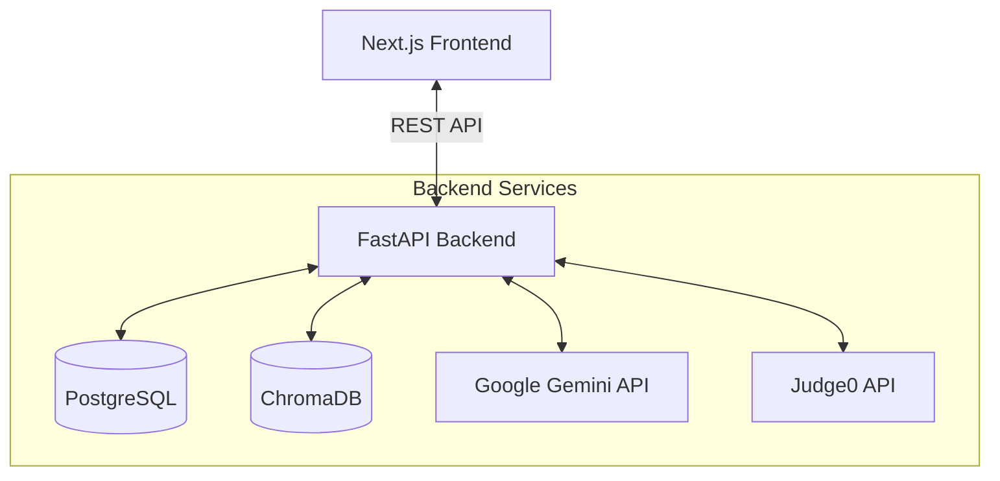

# InterviewAI 🤖

An AI-powered technical interview preparation platform that simulates real-world interviews using Large Language Models (LLMs), Retrieval-Augmented Generation (RAG), and real-time code evaluation.

Built with a **FastAPI** backend and a **Next.js 16** (App Router) frontend, InterviewAI leverages **Google Gemini**, **ChromaDB**, **PostgreSQL**, and **Judge0** to provide dynamic, personalized, and adaptive interview experiences.

---

## ✨ Key Features

- **AI-Generated Technical Questions:** Dynamically generated domain-specific coding and theory questions.
- **Resume-Based Personalization:** Parses user resumes to tailor interviews based on past projects and skills.
- **Real-Time Code Evaluation:** Integrated Monaco Editor with instant code execution and testing via the Judge0 API.
- **RAG-Powered Concept Evaluation:** Context-aware grading and assistance using ChromaDB for accurate theory answer assessment.
- **Adaptive Difficulty:** Automatically adjusts the complexity of follow-up questions based on the candidate's performance.
- **Interactive Dashboard:** Tracks performance history, domain-specific stats, and score trends with animated Recharts visualizations.
- **Modern Dark-Mode UI:** Polished interface featuring shadcn/ui, Tailwind CSS v4, and Framer Motion for seamless transitions.
- **Secure Authentication:** Robust JWT-based auth system.

---

## 🛠️ Tech Stack

### Frontend
- **Framework:** Next.js 16 (App Router), React 19, TypeScript
- **Styling:** Tailwind CSS v4, shadcn/ui
- **Animation:** Framer Motion
- **State Management:** Zustand, TanStack Query
- **Editor & Charts:** Monaco Editor, Recharts

### Backend
- **Framework:** FastAPI, Python 3.11
- **Database & ORM:** PostgreSQL, SQLAlchemy, Alembic
- **Vector Database:** ChromaDB
- **AI & NLP:** Google Gemini API (`gemini-2.5-flash`), `sentence-transformers` (`all-MiniLM-L6-v2`), spaCy
- **Code Execution:** Judge0 API (via HTTPX)

### Infrastructure
- **Containerization:** Docker & Docker Compose
- **Package Management:** Poetry (Backend), pnpm (Frontend)

---

## 🏗️ System Architecture



---

## 🚀 Getting Started

### 1. Prerequisites
- [Docker & Docker Compose](https://www.docker.com/)
- [Node.js 20+](https://nodejs.org/) & [pnpm](https://pnpm.io/)
- [Python 3.11+](https://www.python.org/) & [Poetry](https://python-poetry.org/)
- API Keys: [Google Gemini](https://aistudio.google.com/) & [Judge0](https://rapidapi.com/judge0-official/api/judge0-ce)

### 2. Clone the Repository
```bash
git clone https://github.com/Haris-Mahmood-21/ai-interview-platform.git
cd ai-interview-platform
```

### 3. Start Infrastructure Services
Start PostgreSQL and ChromaDB via Docker:
```bash
docker compose up -d
```

### 4. Backend Setup
```bash
cd backend

# Configure and install dependencies
poetry config virtualenvs.in-project true
poetry install

# Download spaCy model
poetry run python -m spacy download en_core_web_sm

# Setup environment variables
cp .env.example .env
```
Update your `.env` with the necessary keys (e.g., `GEMINI_API_KEY`, `JUDGE0_API_KEY`).

**Database Setup & Seeding:**
```bash
poetry run alembic upgrade head
poetry run python scripts/seed_questions.py
poetry run python scripts/ingest_knowledge_base.py
```

**Start the API Server:**
```bash
poetry run uvicorn app.main:app --reload --port 8000
```
> **Backend API Docs:** `http://localhost:8000/docs`

### 5. Frontend Setup
In a new terminal window:
```bash
cd frontend

# Install dependencies
pnpm install

# Setup environment variables
cp .env.example .env.local
```

**Start the Development Server:**
```bash
pnpm dev
```
> **Frontend App:** `http://localhost:3000`

---

## ⚡ Performance Highlights

The backend has been rigorously optimized for minimal latency during interview flows:
- **Concurrent Judge0 Execution:** Test cases for code submissions run in parallel via `ThreadPoolExecutor`, reducing worst-case latency from $O(N)$ to $O(1)$.
- **Combined LLM Evaluation & Follow-ups:** Theory answer evaluation and follow-up question generation are merged into a single Gemini prompt, eliminating a redundant round-trip.
- **Preloaded AI Models:** SentenceTransformer, ChromaDB, and Gemini client instances are warmed during FastAPI startup (`lifespan`), removing cold-start delays.
- **Optimized DB Connection Pool:** Tuned SQLAlchemy engine configurations (`pool_size=10, max_overflow=20`) to handle concurrent user loads efficiently.

---

## 🎨 UI/UX Highlights

The frontend was completely redesigned to prioritize focus and flow:
- **Centralized Design System:** Fully tokenized CSS variable system mapping to a strict dark-mode-only palette (gray-950/indigo-600).
- **Smooth Interactions:** Framer Motion powers page transitions, staggered dashboard reveals, and score animations to prevent jarring instant state changes.
- **Contextual Loading:** Loading states are directly tied to actual backend latency points (e.g., "Evaluating your answer..." vs generic spinners).
- **Typography:** Purposeful pairing of Inter for UI and JetBrains Mono for the integrated coding environments.

---

## 📁 Project Structure

```text
ai-interview-platform/
├── frontend/             # Next.js App Router application
├── backend/              # FastAPI server, AI logic, and database models
├── docker-compose.yml    # Postgres & ChromaDB containers
└── README.md             # Project documentation
```

---

## 🔮 Future Improvements
- Voice-based interviews (Speech-to-Text / Text-to-Speech)
- AI interview analytics and deep insights
- Live collaborative peer interviews
- Multi-language support for diverse coding challenges
- Advanced interviewer personas (e.g., "Strict Technical Lead", "Helpful Mentor")

---

## 📄 License
This project is developed for educational and learning purposes.