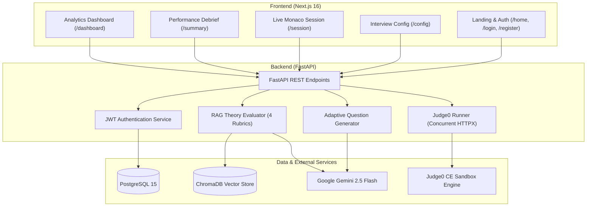

# System Architecture & Technical Specifications

This document outlines the architecture, data models, communication flows, and design decisions for the **AI Interview Platform**.

---

## 1. High-Level Architecture Overview

The system is organized into a full-stack monorepo featuring a decoupled client-server architecture:

```
ai-interview-platform/
├── frontend/           # Next.js 16 (App Router), React 19, TypeScript, Tailwind CSS v4
├── backend/            # FastAPI, Python 3.11, SQLAlchemy, Alembic, ChromaDB
├── docs/               # System documentation and roadmap planning
└── docker-compose.yml  # Container services (PostgreSQL 15, ChromaDB)
```



---

## 2. Core Subsystems

### 2.1 Backend (`/backend`)
- **Web Framework:** FastAPI with synchronous route handlers executed across Starlette's threadpool.
- **Relational Storage:** PostgreSQL managed via SQLAlchemy 2.0 ORM and Alembic schema migrations (`backend/migrations`).
- **Vector Retrieval:** ChromaDB instance pre-indexed with domain-specific knowledge chunks (`dsa`, `oop`, `ml`, `react`) using `sentence-transformers` (`all-MiniLM-L6-v2`).
- **Question Generation:** Gemini API batch generation producing 2 coding challenges and 3 conceptual theory questions tailored to selected domain or uploaded resume.
- **Code Execution:** Live Python execution powered by Judge0 CE sandbox running test cases concurrently via `ThreadPoolExecutor`.

### 2.2 Frontend (`/frontend`)
- **Framework:** Next.js 16 App Router using Turbopack and React 19.
- **Styling:** Tailwind CSS v4 with custom dark midnight-navy tokens in `src/app/globals.css`.
- **State Management:** Zustand stores with `persist` middleware for session tokens and live interview state (`useAuthStore`, `useInterviewStore`).
- **Editor:** `@monaco-editor/react` with custom syntax highlighting and responsive execution panel.
- **Analytics:** Recharts data visualization (`DomainRadar`, `ScoreTrendChart`) and interactive metric statistics.

---

## 3. Directory Layout Standards

| Directory | Purpose |
|:----------|:--------|
| `backend/app/models/` | SQLAlchemy ORM database models (`User`, `Attempt`, `Question`, etc.) |
| `backend/app/routers/` | FastAPI endpoint route controllers (`auth`, `code`, `theory`, etc.) |
| `backend/app/schemas/` | Pydantic data validation and serialization models |
| `backend/app/services/` | Business logic, LLM clients, Judge0 runner, and RAG evaluation |
| `backend/migrations/` | Version-controlled Alembic database schema migrations |
| `backend/knowledge_base/`| ChromaDB client, ingestion scripts, and domain source corpora |
| `backend/scripts/` | Administrative utilities and database seed scripts |
| `frontend/src/app/` | Next.js App Router route hierarchy |
| `frontend/src/components/` | Reusable React UI primitives and domain widgets |
| `frontend/src/hooks/` | Custom React hooks (`useMounted`) |
| `frontend/src/lib/` | API client, domain definitions, and styling helpers |
| `frontend/src/store/` | Zustand state stores |
| `frontend/src/types/` | TypeScript interfaces and type definitions |
| `docs/` | System architecture, setup documentation, and planning guides |

